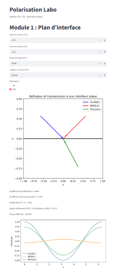

# PolarizationLab

An interactive Python application for exploring light polarization and Fresnel equations.

I developed this project independently, outside my university coursework, to better understand how light behaves at the interface between two dielectric media.

The app is built with Streamlit and allows users to change optical parameters and visualize their effects on reflection and transmission.



## What it does

- Calculates Fresnel reflection and transmission coefficients for TE and TM polarizations.
- Visualizes incident, reflected and transmitted rays.
- Shows how reflectance and transmittance vary with the angle of incidence.
- Calculates the Brewster angle.
- Displays electric field amplitudes.

## Physics

The calculations are based on Snell's law:

$$
n_1 \sin(\theta_i) = n_2 \sin(\theta_t)
$$

and the Fresnel equations for an interface between two dielectric media.

The current model assumes ideal dielectric media. Total internal reflection is not yet fully handled.

## Tools

Python, NumPy, Matplotlib, Streamlit.

## Run locally

```bash
git clone https://github.com/JulietteLelaquet/PolarizationLab.git
cd PolarizationLab
pip install -r requirements.txt
streamlit run app.py
```
